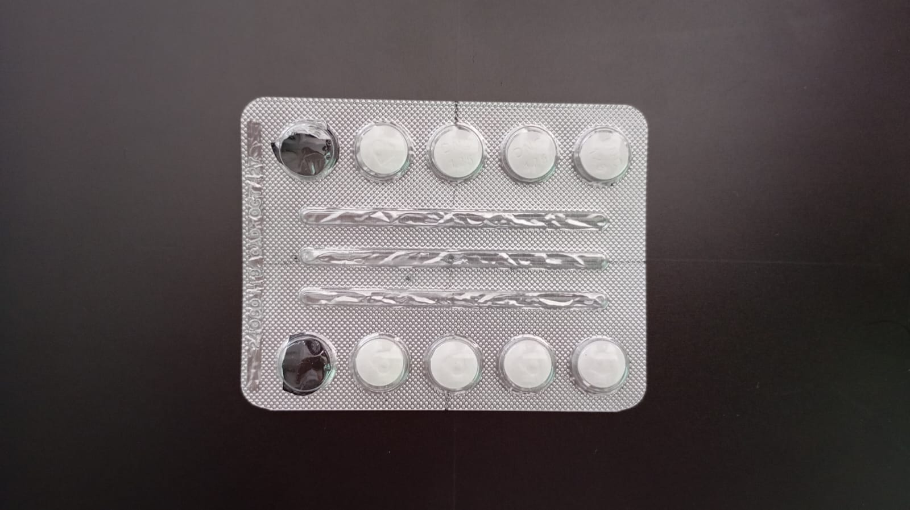

<div align="center">

# ✦ deteccion-pastillas

### Missing tablet detection

Prototype that detects circular tablet positions in blister photos and estimates missing pills.


[GitHub profile](https://github.com/Greys2004) 

</div>

---

## 🖼️ Sample input



## ✦ Highlights

- Upload blister photos through Streamlit
- Grayscale and Gaussian filtering
- Hough circle detection and local threshold analysis
- Highlight detected tablet positions and count potentially missing tablets

## ⚙️ Technologies

`Python` · `OpenCV` · `Streamlit` · `NumPy`

## 🚀 Run locally

```bash
python -m pip install -r requirements.txt
streamlit run proyecto.py
```

Use a Python virtual environment where possible. Upload a JPG/PNG in the Streamlit UI.

## 📌 Notes

The screenshot you supplied illustrates **10 detected positions and 2 marked as missing**, for that sample only. Accuracy is sensitive to lighting and camera angle; this is not a clinical or pharmaceutical quality-control system.

Never commit production secrets or credentials.

---

<div align="center">**Greys Alexa Almanza Vega** · Software Engineer 💜</div>
